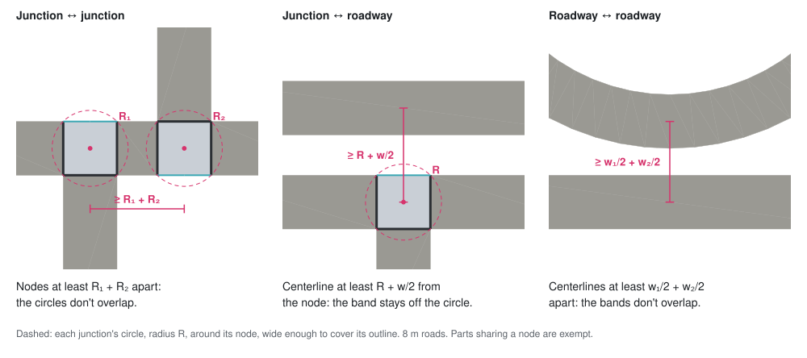

# Intersections

## Scope

- When a section is added: find where it crosses existing sections, split
  both, join them at a shared node.
- Whether it can be built at all: roads cover ground, so the junctions and
  roadways the edit would leave must not overlap, and must stay within
  practical limits.
- Out of scope: how a junction looks, how traffic moves through it. A
  junction is an ordinary node, drawn like any other.

## What a crossing is

Two sections' centerlines meeting at a point they don't already share.

- Both sections are split there. The new node is an ordinary node.
- Several meetings (a straight across a bend, two curves) → one junction
  each. The crossed section is cut at every one.
- Already share a node → not a crossing _at that node_ (roads drawn end to
  end, a road started from a node). The same pair can still cross elsewhere.
- Collinear overlap → no single point → not a crossing. A road drawn on
  top of another stays a second road.
- Grazing → a single point → a crossing. A shallow angle is never the reason
  to refuse; pieces that come out too short are (see Clearance).
- Centerlines only: two roads whose bands overlap without their centerlines
  meeting do not cross there.
  - → width never makes a junction, it only refuses.

## Plan, speculate, clear, then apply

- Checked only when a section is added, since nothing else can create a
  crossing. No pass over the whole network.
- Four steps:
  1. **Plan**: a standalone value saying which sections are cut, where the
     junctions land, and whether it can be built. Knows nothing of road
     width, and doesn't touch the network.
  2. **Speculate**: lays out the network as the plan would leave it (see
     The speculative network).
  3. **Clear**: decides whether the plan can be built, given the ground it
     would cover. Leaves the plan itself as it is: which sections are cut,
     where the junctions land.
  4. **Apply**: carries out the plan and decides nothing new.
- Planning sits in the network layer; speculating and clearing in the
  layout layer, since width belongs to the layout (`docs/road-layout.md`)
  and crossings do not.
- The layout layer runs the first three and hands back one **road plan**:
  the section plan, whether it can be built, the speculation it was
  cleared on, and the nodes and sections a refusal is about.
  - every parts that is in violation, not just the first
- A geometry that allows no roadway is refused before speculating.
  - e.g. an arc of radius `≤ w/2`: its inner edge doesn't exist
- A plan can be made without applying it → a tool can preview a section
  while it is still being dragged, and what lands is exactly what was shown.
- A plan is valid only for the network it was made on. Applying it after
  the network changed is an error (not a refusal), and nothing is built.
- A refusal is a full plan too: the whole section and the junctions it
  would have made, so it can be displayed. Only a buildable plan guarantees
  something to build.
  - Exception: an arc whose third point is in line with its ends has no
    circle → its refusal is the straight between the ends, no junctions.
- All or nothing: every piece and junction lands together. A refusal comes
  before anything is created → nothing to roll back.

## The speculative network

- The **speculative network** is the network as the plan would leave it: the
  real one with the plan applied to a throwaway copy of it.
- Clearance is measured on its layout, never on the network as it stands.
- Built by applying the plan, not by working out what it would do → measured
  by the rules that will really run, rather than by a second guess at them.
- Built once per plan, and discarded with it. Read by the clearing step and
  by the tool's preview.
- Only the parts the edit changes are laid out there. The rest is the same in
  both networks, and is read from the layout already at hand.
- What an edit changes:
  - the junction at every point the plan runs through
  - the junction at either end of every section it cuts
    - a cut shortens the section → a setback there may come out differently
  - the roadway of every section meeting a changed junction
- A cut section is gone there, replaced by the two pieces left where it was →
  the pieces are what the new parts are measured against.

## Clearance

Two parts of the layout may not overlap. `w` is the width of a
road.

- Three pairings: junction ↔ junction, junction ↔ roadway, roadway ↔
  roadway.
- A junction is measured by a circle about its node, wide enough to cover
  its outline.
  - conservative: refuses a layout that would just have fitted, never allows
    an overlap
- A junction and a roadway are clear where the roadway's centerline stays
  `R + w/2` from the node, `R` the junction's circle.
  - measured to the nearest point between the roadway's ends → its ends
    count as round, not square: conservative again
  - that extra half disc lies inside the end's own junction circle → it
    refuses nothing junction ↔ junction doesn't already
- Two roadways are clear where their centerlines stay `w₁/2 + w₂/2` apart:
  their two half-widths added up.
  - two straights refuse nothing junction ↔ roadway doesn't already: they
    come closest at a roadway's end, whose junction's circle then reaches
    the other roadway
  - → it only adds where an arc bulges toward another roadway
- Exempt: parts sharing a node.
  - they meet by design, and the junction rules (`docs/road-layout.md`)
    already say how
  - their bands would overlap near the node; the junction's setbacks end
    them before they do
- Any of these → the plan cannot be built.

## Practical limits

Layouts that don't overlap but no real road would have. Measured in the
same step, on the same changed parts.

- A junction's bounding circle: `R ≤ 25 m`.
- A junction covers its node (`docs/road-layout.md`, Joins).
- A roadway: length ≥ 30 m.
- A curved roadway: radius ≥ 10 m.
- A biarc roadway: radius ≥ 10 m, on each of its arcs.
- Parts the edit doesn't change are not measured again.
- Any of these → the plan cannot be built.

## What a refusal names

- Every rule is measured → the refusal names every part taking part.
- A part is named by one rule at most: once named, it leaves the rules
  after it.
- Two roadways that both end at named junctions are not measured against
  each other: their conflict is the junctions'.
- Rule order: practical limits, junction ↔ junction, junction ↔ roadway,
  roadway ↔ roadway.

## Tolerances

In meters, never pixels: the result must not depend on zoom (same reason
the grid pitch is fixed).

- **1 cm: same place.** A crossing within 1 cm of a node, or of another
  crossing, _is_ that point.
  - → a road ending on a road is a T-junction, not a near miss
  - → a road drawn through a node reuses it
  - → a road across two roads 5 mm apart makes one junction cutting all
    three (6 sections), not two nodes side by side
  - The new section's own ends too: within 1 cm of a road → on it, and cut it.
- Further apart than that → two places, and Clearance measures the junctions
  they make against each other.
- No minimum length here: Practical limits sets one, on the roadway.

## Splitting

- Same kind on both sides: straight → 2 straights, arc → 2 arcs following
  the original bend.
- Not exactly the same circle: the node sits where the tolerances put it,
  possibly slightly off the road (the second of two roads 5 mm apart gets a
  5 mm kink), and each half is the arc through its actual ends.
  - The difference is far too small to see at road-section lengths.
  - Rejected: moving the node to fit the arc, which would let geometry
    decide where junctions go.
- A biarc:
  - cut on one piece → that piece splits as an arc would, the other stays
    → an arc and a biarc
  - cut at `J`, within 1 cm → its two pieces, as they are
  - the biarc half keeps `J`, each piece cut as an arc is (not exactly the
    same circle, above) → a node slightly off the road can leave a kink that
    small at `J`

## Relationship to other modules

- Crossings and splitting are in `src/core/network/`, above and outside
  `RoadNetwork`:
  - a split edits several primitives (+1 node, +2 sections, −1 section)
  - the model stores, it doesn't decide
  - uses only the network's public API
  - knows nothing of road width
- Speculating and clearance are in `src/core/layout/`.
  - → a tool asks the layout layer for a road plan, if the road plan is
    buildable, applies the section plan of it
- The geometry (`src/core/geometry/`) knows nothing about the network, just
  points and distances.
  Only the pair of shapes varies; where the result goes doesn't.
- Editing tools call this instead of adding a section directly. The tool
  picks the endpoints and reports refusals; this decides what the network
  does between them.
