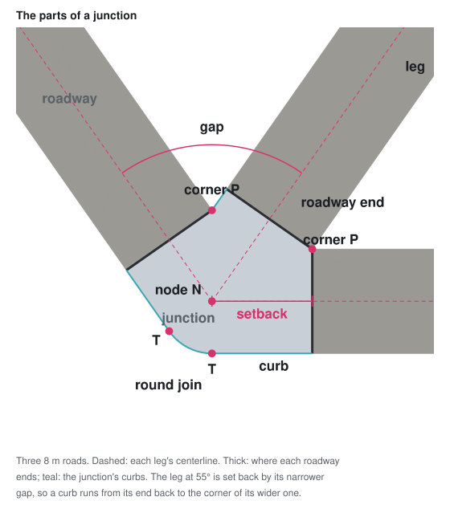

# Road Layout

## Scope

- The network as it lies on the ground: a junction at every node, a roadway
  along every section.
- Derived from `RoadNetwork`, never stored.
  - `RoadNetwork`: what connects to what. Layout: how it lies on the ground.
- Pure geometry, not a drawing → the renderer (`docs/road-surface.md`) is one
  reader of it, not its owner.
- Why these shapes and not others: `docs/ideas/junction-polygon.md`.
- Out of scope: refusing edits. The layout describes any network it is given,
  however badly it fits.

## Junction

- One per node, every node: a dead end and a 180° join too.
  - → a reader never special-cases a node by how many sections meet it.
- Worked out from that node and the sections meeting it alone.
- Roads of different widths may meet; each keeps its own width up to its
  roadway's end.

### Gaps

- Gap: the angle between two neighboring roads, between the directions they
  leave the node by.
  - An arc leaves along its tangent at the node, not toward its far end.
  - n roads → n gaps, adding up to 360°.
  - A dead end is one gap of 360°.
- Each gap is joined one of two ways (Joins, below), and sets its two roads
  back as its join says.

### Setbacks

- The setback of each section meeting the node: how far from the node its
  roadway ends, measured along the centerline.
  - Along the centerline, not a curb → the setbacks a road gets from its two
    sides compare directly, on an arc too.
- A road set back from both sides takes the longer setback.
- Not limited by the section's length → a junction needs only its own node,
  not the sections' lengths.
  - As a gap → 0, the setback grows without limit.
- No setback because of an error → error is logged, with the reason.
- Asked for a section not meeting the node → error.

### Joins

- The area the junction covers, walked around the node gap by gap.
- `T`, of each road: where its curb touches the circle about the node with
  radius its own `w/2` → right beside the node, square to the road. On an arc
  too.
- Numbers in parentheses refer to the picture's panels:

![Nine numbered junctions. 1: two equal roads, a corner at P and round on the other side. 2: a dead end's round cap. 3: a 90° bend between a 16 m and an 8 m road, the circle slid by s to touch the narrower curb. 4: a 70° bend, the narrower curb running on past the node. 5: a 30° bend and 6: a straight join, the circle rounding off the T–X piece on both sides. 7: a curving narrower road, its T–X piece an arc. 8: a skewed T, a road following its curb back to P. 9: a 120° gap, where P, T and X are one point](images/junction-joins.svg)

- Each gap is joined one of two ways:
  - corner: the two curbs on the gap's side cross ahead of the node on both
    roads, at `P` → both roads end square through `P` (1)
    - arc curbs can cross twice → `P` is the crossing nearest the node
  - round, where they don't: below
- Round join, between the wider road (`W` wide) and the narrower (`w`):
  - `X`: where the narrower road's curb crosses the circle about the node
    with radius `W/2`, the crossing nearest ahead of the node
  - the `T–X` piece: the narrower curb, swung about `X` until it runs
    through the wider road's `T`
    - a straight road → the straight from `T` to `X` (5, 6)
    - an arc → an arc of the curb's radius (7)
  - a circle of radius `W/2` slides along the wider road's centerline, away
    from the node, until it touches:
    - on a gap over 180°, once that road's curb, carried on past the node,
      has swung through `T` — `T` on it or on the road's side of it: that
      curb (3, 4)
      - two straights: from a gap of `180° + arccos(w/W)`, however sharp
        the bend from there
    - otherwise: the `T–X` piece (5, 6, 7)
  - outline: along the wider road's curb to the circle, round it to what it
    touches, then along that
  - the wider road is set back as far as the circle slid
  - the narrower road ends square through `X`, or through where the circle
    touches its curb if that is further out
  - where the circle touches the narrower curb behind the node, that curb
    runs on past the node, into the junction (4)
  - nothing runs off as a join nears straight: on two straights the circle
    slides less than `W/2` (6)
  - equal widths → `X` is the narrower road's `T` and the circle doesn't
    slide → the circle about the node (1)
  - a dead end → a round cap (2)
- The round join takes over from the corner where `P` reaches the wider
  road's `T`: `P`, `T` and `X` are one point there (9).
  - equal widths → from 180°
  - two straights → from a gap of `180° − arccos(w/W)`
- A road set back further than a gap asks: the outline follows its curb from
  its roadway's end back to that gap's join.
  - → the join can be an inward corner, with grass beside the strip (8)
- A round join's arcs are true arcs, never broken into pieces.
  - Same rule as picking a section against its circle, not its chords.
- Moving a road a little never makes the junction jump:
  - equal widths: as a gap → 180°, its setbacks and its part of the
    junction → nothing
  - where a gap turns from corner to round, `P`, `T` and `X` are one point
    and the circle hasn't slid (9)
  - where the circle turns from the `T–X` piece to the curb, the two are
    one line: the curb runs through `T`, so the swing is nothing (9, other
    side)
  - both sides of a straight join follow the same rule (6)
- The node lies inside the junction → centerlines never run over grass.
  - Only a round join between two widths can leave it out: on a bend so
    sharp that its circle slides past the node (two straights: sharper than
    `180° − arcsin(1 − w/W)`).
  - The junction is drawn all the same, and says so; the clearing step
    refuses such a network (`docs/intersections.md`, Practical limits).

## Roadway

- One per section: the section between the setbacks at its two ends.
- As wide as its section's road.
- A shorter section of the same kind:
  - straight → the straight between the setbacks
  - arc → the same circle, between the setbacks
- Ends square to the road, whether that end is set back or not.
- Junctions and roadways cover the road with no overlap and no gap. A
  roadway's end is the border between the two.
- Knows its length: the section's, less the setback at each end. A setback is
  measured along the centerline, so this holds whatever shape it takes.
- Negative where the two setbacks overlap: the section is too short for its
  junctions, and an edit leaving it so is refused (`docs/intersections.md`,
  Clearance).
  - The outline then runs backwards. Ugly but harmless: only a refused
    plan's network gets there.
- Knows which of its ends has a crossing (`docs/road-markings.md`).

## Outline

- Every part says what ground it covers, as an outline. Each kind says it the
  way that kind is shaped:
  - junction → as described above in the Junction chapter
  - roadway → a band defined by its centerline and the width of the road
- An outline names the network part it belongs to.
- Each piece of a junction's outline says what it borders: a curb or a
  roadway's end.
- Says what ground the part covers, not how to tesselate or render it.

## Derivation

- Each part (a setback, a junction, a roadway) is worked out from the network
  and from parts before it, never from one after it:
  - setbacks at a node ← the sections meeting it
  - junction ← the setbacks at its node
  - roadway ← the setbacks at its two ends
- Each is a pure function of its inputs, usable without a cache.
  - → the edit planner can ask about a network that isn't built yet.
- A setback is fixed by (node, section): a section joins two distinct nodes,
  so it meets a node at most once.

## `RoadLayout`

- One object answers for the whole layout: the junction at a node, the
  roadway along a section.
- Nothing is worked out ahead: a part is computed the first time it is asked
  for, then kept.
  - → a reader pays only for what it reads.
- Everything is dropped when the network's version changes.
  - Coarse, like the version counter itself.
  - Checked on every question → nothing to notify, nothing to subscribe to.
- A junction or roadway is a snapshot of the version it was read at, and says
  so about nothing: one kept past an edit answers as it did before, unwarned.
  - → read a part again after an edit rather than storing it.
- Junctions and roadways share the one cache: a roadway reads junctions, and
  both must come from the same version.
- The whole layout can be iterated.

## Relationship to other modules

- In `src/core/layout/`, outside `RoadNetwork`: uses only its public API.
- `src/render/` draws it (`docs/road-surface.md`).
- Edits are validated against it via `clearance` (`docs/intersections.md`).
