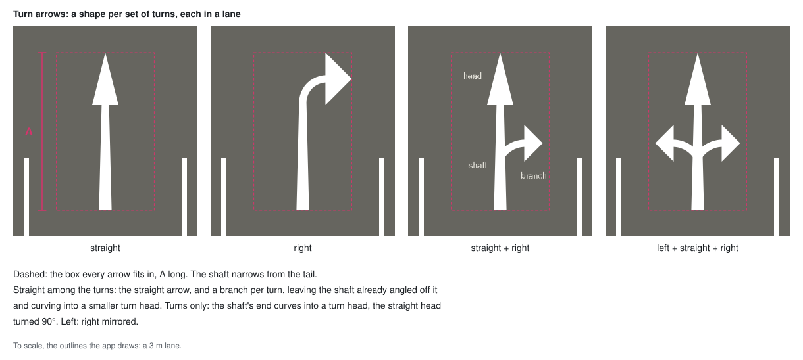

# Road Markings

## Scope

- Paint on the road surface (`docs/road-surface.md`): a solid line along
  each curb, lane marks set by the road's lanes each way, zebra crossings and
  turn arrows at junctions.
- Out of scope: stop lines.

## Markings

`w` is the road width, `ℓ` a line's width.

- Edge line: solid, set in `e` from the curb.
  - The inset keeps the line off the mesh edge.
- Along every curb: both sides of every roadway, and on through junctions.
- Lane marks: by the lanes each way in the section's road profile.
  Roadways only → they stop at junctions.
- One color for every marking: white.

## Lane marks

`v` is the inner lane width: a constant, in meters, line center to line
center.

- 1 lane each way: dashed centerline.
- 2 lanes each way: solid centerline, and a dashed divider `v` out on each
  side.
  - Every lane is `v` wide (`docs/lanes.md`) → divider `i` at `i · v` from
    the centerline.
    - The rest of the width is room at the curb, not a lane, e.g. for
      parking. No line between it and the outer lane.
- More: no lane marks → edge lines and crossings only.

## Fitted pattern

A mark and a gap, repeated over a stretch. `L` the stretch's length, `P`
the period (mark + gap).

- A whole number of periods, stretched to fit exactly:

      n  = round(L / P)
      P' = L / n

- The mark is centered in each period → half a gap at each end.
- `n = 0` → no marks.
- `P'` is within `1 / 2n` of `P`.

## Dash pattern

A fitted pattern along a dashed lane mark. `δ` the dash's share of a period.

- `L`: the roadway's length, less its crossings.
- The same along every dashed mark of a roadway → its dividers' dashes are
  side by side.
- The dash is a share of the period → stretches with it.
- Half a gap at each end:
  - → two roadways meeting at a 180° join: the two half gaps make one gap →
    the pattern carries on across the node.
  - → at a junction or a crossing: half a gap before it.

## Junction ends

A roadway's end where it meets a junction: 3 or more sections meet at its
node.

- Each gets a crossing and turn arrows (below), one after the other, where
  the roadway has room for them.
  - Per end → a roadway has them at either end, both or neither.
  - None at a dead end or a join of two.

## Crossings

A zebra crossing at a junction end.

- `D` deep along the road, starting right at the roadway's end.
- No lane marks on it.
- A roadway under `2D` long has none → two crossings never overlap.
- Bars run along the road: a fitted pattern across it, between the edge
  lines → `L = W = w − 2(e + ℓ)`.
  - A bar is half its period.

## Turn arrows

An arrow in a lane at a junction end: the turns the lane can take there.
`A` is its length, `g` its gap to the crossing ahead.

- In every lane running into a junction end.
  - Every road is two-way → every junction end has lanes running in.
- A roadway under `2D + 2g + A` long has none: room for both crossings and
  the arrows at both ends.
  - Its two ends' arrows lie in opposite lanes → side by side → one `A`.
  - → an arrow stays `g` clear of both crossings, and is never without the
    crossing ahead.
- Shows the turns of the connections leaving its lane's exit
  (`docs/lanes.md`): any of left, straight, right → 7 arrows.
  - Never none: a junction leaves no lane dead.
  - Never a U-turn: a junction has none.
- Tip `g` back from the crossing, `A` long behind it.
- Square to the road, as the crossing's edge: the roadway's centerline cut
  back `D + g` at that end, then moved sideways as its lane is → the tip.
  - → exact on arcs and biarcs.
- Centered in its lane, narrower than it → clear of the lane marks → the
  dash pattern is unchanged.

### Shape

- A shaft, narrowing from the tail, and a head per turn.
- Long along the road, as road arrows are: read at a low angle.
- Straight: a head on the shaft's end.
- Turn head: the straight head turned 90° → long along the road, short the
  way it points.
- Turns only: the shaft's end curves into a turn head per turn.
- With straight: each turn a branch, leaving the shaft partway up already
  angled off it, into a smaller turn head.
- Left: right mirrored.

### Drawn as meshes

- Not in the surface shader: a shape of its own, no pattern along the road.
- One mesh per arrow shape, drawn once per arrow (instanced).
- At the surface's height, drawn over it by a depth offset, not a height →
  holds for a tilted camera.
- Takes its roadway's state (`docs/part-states.md`).

## Drawn in the shader

Markings other than turn arrows are not geometry of their own: the fragment
shader colors each pixel of the surface from values its vertices carry,
interpolated across each triangle.

- Every vertex carries where it is on its road:
  - `side`: `±1`, which edge of the roadway it is on.
  - `halfWidth`: `w/2`, the same at every vertex of a roadway.
  - → `u = side · halfWidth`, worked out in the vertex shader: signed
    distance from the centerline, interpolated for each pixel.
    - Width only in `halfWidth` → a width that varies by road needs no
      change.
  - `t = (s − c) / P'`: distance along the dashed stretch, in dash periods.
    `s` is measured from the roadway's start, `c` is `D` with a crossing
    there, else 0.
  - `k = (u + W/2) / P'`: distance across, from the inner edge of the edge
    line, in bar periods.
    - Linear in `u` → interpolates exactly, like `u`.
  - `a`, `b`: distance from the start, and from the end, where that end has
    a crossing. Far (over `D`) where it has none.
  - A junction's vertices: `a`, `b` far.

- A pixel is marked where:

      edge line:        e < halfWidth − |u| < e + ℓ
      on a crossing:    min(a, b) < D
      dashed:           |fract(t) − 0.5| < δ/2
      crossing bar:     on a crossing  and  |fract(k) − 0.5| < 1/4
                        and  halfWidth − |u| > e + ℓ

  and by lane marking, never on a crossing:

      1 lane:   centerline dash   |u| < ℓ/2  and  dashed
      2 lanes:  centerline        |u| < ℓ/2
                divider dash      ||u| − v| < ℓ/2  and  dashed

- `t` and `k` already include the roadway's own `P'`, `a` and `b` its
  crossings → nothing per roadway is left for the shader but its lane
  marking.

## A program per lane marking

- One fragment shader per lane marking. The lane marks are its own; edge
  lines, crossings and part states are code they share.
  - Not one shader branching on the lane count: every new marking (one-way
    roads, parking) would add a branch to it.
- Profiles marked alike share a program → and a mesh.
- Every marking's roadways carry the same vertex values → one tessellation,
  one vertex shader.
- Junctions: the program with no lane marks.

## Follows the chords, not the arc

- Values are linear inside a triangle → `u = const` is a straight line
  there.
- A roadway quad on an arc is an isosceles trapezoid → its two chords are
  parallel → the lines of constant `u` run parallel to them, and meet across
  the diagonal without a kink.
  - → a line keeps its distance from the drawn edge exactly.
  - Measured against the true arc instead, it would drift from the drawn
    edge by the sag, up to the tessellation's tolerance.
- Costs, both far under a millimeter at the tessellation's tolerance:
  - the chords are `w·cos(α/2)` apart, `α` the angle a quad covers → the
    lines are thinner by `cos(α/2)`
  - a dash end inside a quad is cut slightly slanted

## Through junctions

- A junction is drawn as a strip of quads along its outline, `d₀` deep, plus
  a fill (`docs/road-tessellation.md`).
- Each strip quad is drawn as a slice of a road: its vertices carry `side`
  and `halfWidth` like a roadway's → the same edge line rule.
- By what its outline piece `ab` borders:
  - a roadway's end → `side · halfWidth` is the distance across that
    road, as if it went on past the cut → the road's edge lines cross the
    cut unbroken and meet the curb's lines at the corners
  - curb → a road whose centerline is the piece moved in by `d₀`:

        halfWidth = d₀,  side = 1 on ab,  0 on the moved piece

    - arcs → one quad per chord → follows the chords, as a roadway does
- `halfWidth` is the same at all vertices of a quad → `u` is a distance in
  meters → `fwidth(u)` still measures a pixel.
- Fill: `side = 0`, `halfWidth = d₀` → `halfWidth − |u| = d₀` everywhere →
  no line.
  - `u` constant → `fwidth(u) = 0`: the shader's `ramp` divides by zero, as
    it already does for `k`, and comes out right.

## Zoom

- A line's edge is smoothed over one pixel.
- A line thinner than a pixel fades out instead of flickering.

## Relationship to other modules

- Drawn by the road surface, in its own meshes, in `src/render/`: one per
  lane marking for the roadways, one for the junctions.
- The dash pattern is worked out in `src/core/layout/`, from the roadway's
  length.
- Turn arrows are placed in `src/core/lanes/`, from the lane graph's
  connections, and drawn in `src/render/`, beside the road surface.
  - `g` and `A` live in `src/core/layout/`: the crossing rule needs them.
