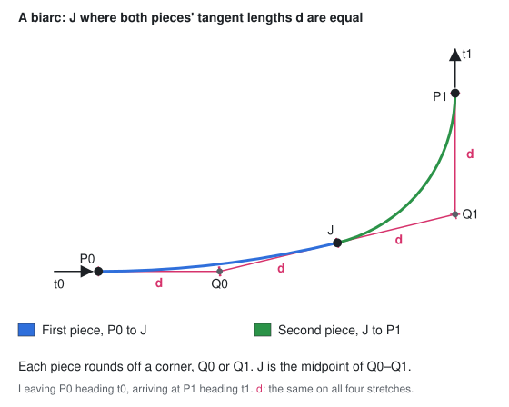

# Road Network Data Model

## Scope

- The graph of nodes and sections that every other module reads or edits.
- Pure logic: no rendering, no input handling, no snapping.
- Automatic intersections must fit without reshaping the model.

## What it holds

- **Node**: an exact position on the XZ ground plane. Knows which sections
  meet at it.
- **Section**: an edge between two nodes, plus its centerline geometry, its
  length along that centerline and its road profile.
- **Road profile**: the road across its width — how wide it is, and how many
  lanes run each way.
  - Read-only → sections may share an instance: the pieces of a cut section
    can keep the profile it had.
- **Geometry**: how a section runs between its nodes: straight, a circular
  arc, or a biarc.
- Nodes and sections have stable ids, valid for the element's lifetime.

### Arcs

An arc is fixed by a third position it passes through, between its ends.

- 3 points not in a line → exactly one circle through them → that point
  settles:
  - the radius
  - which way the road bends
  - the short or the long way round
- The circle is derived from the three, never stored → one description of
  the arc, with nothing beside it to keep in step.
- The ends already fix all but one degree of freedom → many third points
  describe the same arc.
  - → two sections have the same shape when their circles and ends agree,
    not when their stored points do.

### Biarcs

Two pieces end to end, tangent where they meet: the join `J`.

- Each piece is a straight or an arc → the road runs smoothly end to end,
  its curvature changing only at `J`.
  - Why: a road leaving one direction and landing in another, smooth at
    both ends. An arc can't: with its ends fixed, its one degree of freedom
    matches a direction at one end only.
- Stored: `J`, and each piece's own geometry: `from → J`, then `J → to`.
  - → a piece is an ordinary straight or arc: every rule and query on
    those applies to it as it is.
  - Reversed → the pieces swap, nothing else changes → symmetric, like an
    arc.
- More is stored than the shape needs → tangency at `J` is not built in:
  the biarc is made tangent, and nothing checks it.
  - A kink at `J` only looks worse: no rule or query depends on it.
- Length: the two pieces' added up.
- `J` from the ends and their directions alone: both pieces' tangent lengths
  `d` equal.
  - Each piece rounds off a corner, `Q0` or `Q1` → `J` is the midpoint of
    `Q0–Q1`.
  - Reversed → the same `J`.

## Rules

- A section joins two distinct, existing nodes.
- Nothing reshapes what is built: no node moves, no section is rebent. A road
  is changed by removing it and building it again.
  - → a section can be measured once, when it is created, and its length
    stored on it.
- An arc's third position is not in line with its ends: no circle through
  them → no arc to build.
- A biarc:
  - `J` is on neither end → each piece has a length
    - a join on an end leaves one arc → stored as that arc
  - each piece follows the arc rule above
- Two nodes may be joined by more than one section.
- Removing a section keeps its end nodes, unless it was a node's last
  section.
- A node is removed only by removing every section meeting it.
  - No way to remove a node on its own, and none to leave one with no
    sections.
- Removing a node can strand the node at a section's far end → that one
  goes too.
  - One step, not a chain: a node stranded that way had only the section
    just removed, so nothing hangs off it in turn.

## Relationship to other modules

- The model answers questions and applies edits; it never decides them.
  - Grid snapping and node welding belong to the editing tools.
- Change detection: a version counter bumped on every mutation.
  - Coarse (any edit invalidates everything), but enough to drive a
    rebuild.
- Storage and invariants live in one place. Geometry math, queries, and
  edits spanning several primitives act on the model from outside → it
  doesn't become the home for everything.
