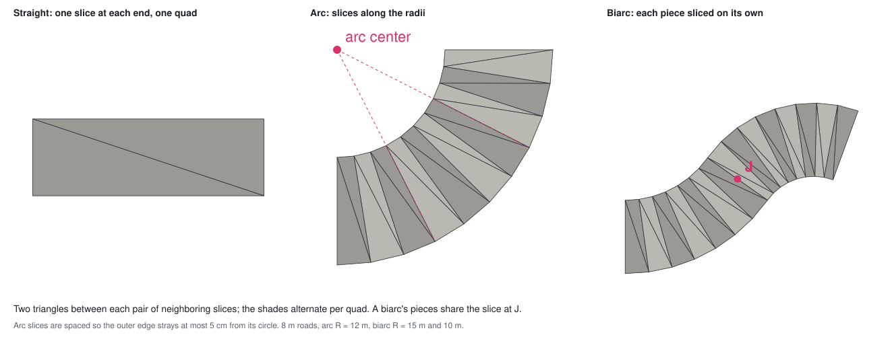
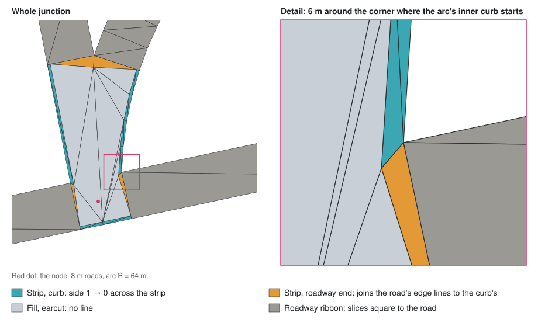

# Road Tessellation

## Scope

- How the road surface (`docs/road-surface.md`) breaks the layout's
  outlines into triangles: roadways and junctions.
- The layout says what ground a part covers; this says how it is cut up.
- Each triangle carries the values its markings are drawn from
  (`docs/road-markings.md`) → the triangles' shape decides where a marking
  can land.

## Roadways

- Cut into slices square to the road; two triangles between each pair of
  neighboring slices.
- Straight: a slice at each end → one quad.
- Arc: both edges are circles around the arc's center, broken at the same
  angles → a strip of quads, each symmetric about its middle.
  - The outer edge sets how fine: at a given angle step it strays furthest
    from its curve.
- Biarc: each piece as its own straight or arc, with a slice at `J` shared
  by both.
  - Each arc's outer edge sets its own step → the two pieces' quads may
    differ in size.
- A slice's two ends keep their curbs all along the road → no twist, at a
  biarc's `J` too.
  - An S-shaped biarc bends both ways → ends named by inner and outer edge
    would swap curbs at `J`.

## Junctions

- Two parts:
  - strip: along the whole outline, `d₀` deep → carries the edge line
  - fill: the rest → carries no line
- `d₀` past the edge line's inner side → the whole line lies in the strip.

### Strip

- Every outline corner moved in by `d₀`, along the bisector of the two lines
  meeting there.
  - At each end of a roadway's end, that line is the road's edge, not the
    cut → the road's edge lines run straight on into the junction.
- One quad per outline piece, between it and its moved copy.
- Neighboring quads share the edge from a corner to its moved copy: the
  bisector → their lines meet in a clean miter, at any corner.
  - → the edge line is the outline moved in, exactly.
- A piece shorter than its corners' miters → its moved copy runs backwards →
  dropped: its neighbors' moved lines meet directly, and its quad becomes a
  triangle.
  - Only next to a corner where the outline turns inward, e.g. a narrower
    road meeting a round join.

### Fill

- The moved outline, triangulated by Three.js's earcut.
- Thin triangles allowed: no line is drawn there.

### Not a fan from the node

- A triangle draws its piece of line relative to its own base, where the
  triangle is deep enough → the piece lands far from its base in a very
  thin triangle.
- Along an arc leg's inner edge the node sees the curb nearly edge-on →
  very thin triangles → pieces of line land far from their chords and miss
  their neighbors; further along, triangles flip and pave grass.
